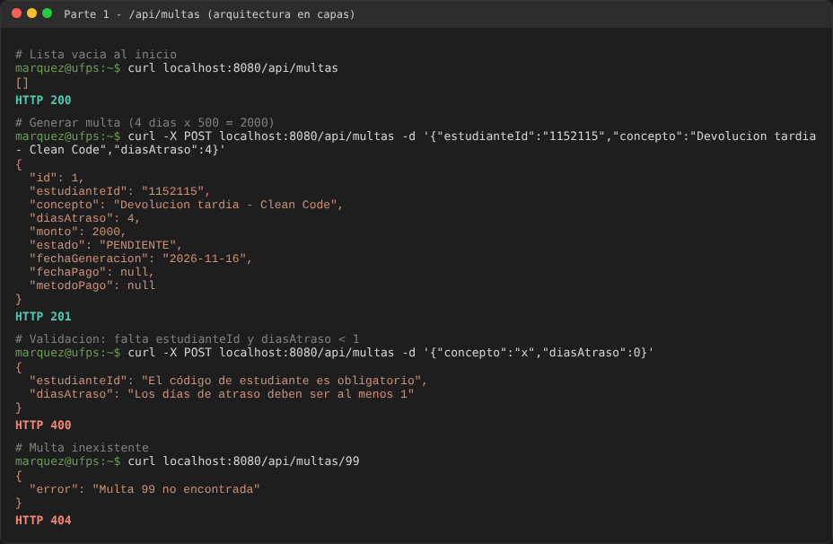
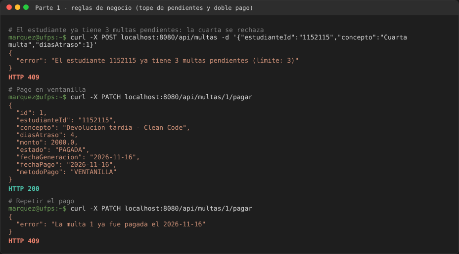
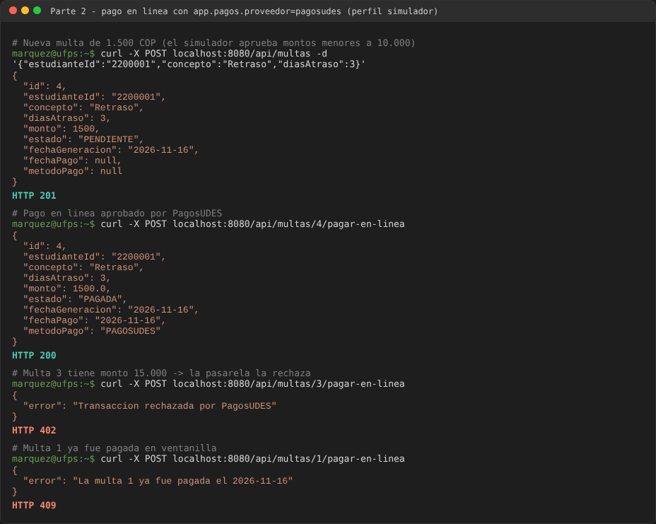
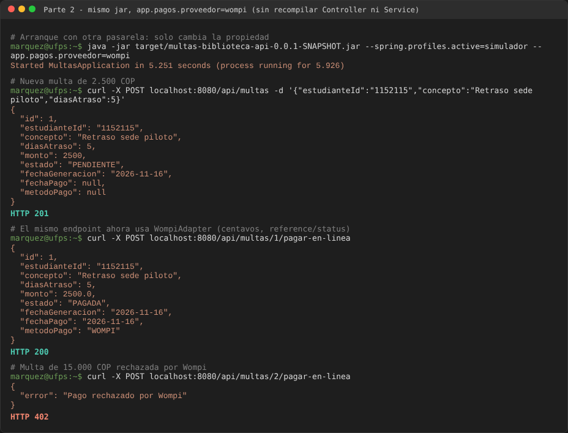
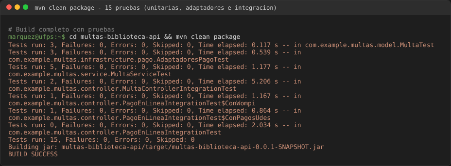

# Post-contenido — Unidad 7: Patrones Arquitectónicos I

**Universidad Francisco de Paula Santander — Ingeniería de Sistemas**
**Curso:** Patrones de Diseño de Software (1156701-A)
**Estudiante:** Diego Armando Márquez Rigaud — **Código:** 1152115

## Descripción

Repositorio del post-contenido de la Unidad 7 de Patrones de Diseño de Software. Un único proyecto
Spring Boot (`multas-biblioteca-api`) para la gestión de multas de biblioteca, con dos partes: una API
REST en capas (Model, Repository, Service, Controller) sobre H2, y pago en línea de multas con dos
pasarelas intercambiables (PagosUDES y Wompi) resuelto con un **puerto de dominio y dos adaptadores**
aplicados solo a la porción de pago.

## Estructura de paquetes final

```
marquez-post1-u7-pd/
├── README.md
├── docs/capturas/                      ← evidencia de los endpoints y del build
└── multas-biblioteca-api/
    ├── pom.xml
    └── src/
        ├── main/java/com/example/multas/
        │   ├── MultasApplication.java
        │   ├── controller/             ← Presentación: MultaController, GenerarMultaRequest, GlobalExceptionHandler
        │   ├── service/                ← Aplicación: MultaService (reglas que necesitan datos + orquestación)
        │   ├── model/                  ← Dominio: Multa (con comportamiento), EstadoMulta, excepciones de negocio
        │   ├── repository/             ← Infraestructura de datos: MultaRepository (Spring Data JPA)
        │   ├── domain/                 ← NUEVO (Parte 2) — Java puro, sin Spring
        │   │   ├── port/PasarelaPagoPort.java
        │   │   ├── ResultadoPago.java
        │   │   └── PagoRechazadoException.java
        │   └── infrastructure/         ← NUEVO (Parte 2) — conoce Spring y HTTP
        │       ├── pago/PagosUdesAdapter.java
        │       ├── pago/WompiAdapter.java
        │       ├── config/RestTemplateConfig.java
        │       └── simulador/SimuladorPasarelasController.java   (solo perfil "simulador")
        ├── main/resources/application.properties, application-simulador.properties
        └── test/java/com/example/multas/   ← 15 pruebas (unitarias, adaptadores, integración)
```

Dirección de las dependencias:

```
MultaController ──► MultaService ──► MultaRepository (JPA)
                         │
                         └──► PasarelaPagoPort  ◄── PagosUdesAdapter / WompiAdapter
                              (domain/, Java puro)    (infrastructure/, RestTemplate)
```

El controlador nunca accede al repositorio: siempre pasa por `MultaService`. Las clases de `domain/`
solo importan `java.*` y la entidad `Multa`; son los adaptadores los que dependen del puerto (DIP).

## Parte 1 — Arquitectura en Capas

- `model/Multa` contiene la regla pura `Multa.calcularMonto(dias)` (500 COP por día, tope 15.000) y la
  transición `marcarComoPagada(metodo)`, que lanza `MultaYaPagadaException` si se repite.
- `repository/MultaRepository` extiende `JpaRepository` y agrega la consulta agregada
  `countByEstudianteIdAndEstado`, que Spring Data traduce a `SELECT COUNT(*)`.
- `service/MultaService` concentra las reglas que necesitan datos: no permite más de **3 multas
  pendientes** por estudiante (409) y usa `Multa.calcularMonto` al generar. No es un passthrough.
- `controller/MultaController` expone `/api/multas`; `GlobalExceptionHandler` traduce las excepciones
  de negocio a 404, 409 y 400.

| Método | Endpoint | Respuesta |
|---|---|---|
| GET | `/api/multas` | 200 — lista |
| GET | `/api/multas/{id}` | 200 / 404 |
| GET | `/api/multas/estudiante/{estudianteId}` | 200 — multas del estudiante |
| POST | `/api/multas` | 201 / 400 (validación) / 409 (tope de pendientes) |
| PATCH | `/api/multas/{id}/pagar` | 200 (VENTANILLA) / 409 (ya pagada) |
| POST | `/api/multas/{id}/pagar-en-linea` | 200 / 402 (rechazo de la pasarela) / 409 (ya pagada) |

## Parte 2 — Pago en Línea con Dos Pasarelas

**Opción elegida: C — puerto de dominio con dos adaptadores, aplicado solo a la porción de pago.**
`domain/port/PasarelaPagoPort` y `domain/ResultadoPago` son Java puro; `infrastructure/pago/PagosUdesAdapter`
e `infrastructure/pago/WompiAdapter` traducen cada formato HTTP externo (idTransaccion/estadoTransaccion
vs. reference/status en centavos) al mismo `ResultadoPago`, y se seleccionan con `app.pagos.proveedor`
sin tocar `MultaController` ni el resto de `MultaService`. `Multa`, `MultaRepository` y `MultaController`
**no** se migraron a hexagonal: eso sí sería sobre-ingeniería para este alcance.

Por qué C y no A o B:

1. **El contrato externo se filtraría.** Cada pasarela tiene un formato distinto (montos en pesos vs. en
   centavos, nombres de campos y estados diferentes). Con la opción A, `MultaService` conocería los DTO y
   las URL de ambas; con B, la interfaz `PasarelaPago` vive en `service/` y nada impide que devuelva DTO
   propios de un proveedor. En C el tipo de retorno lo define el dominio (`ResultadoPago`), así que la
   traducción queda obligatoriamente en el adaptador.
2. **El número de proveedores va a cambiar.** El enunciado anticipa agregar una tercera pasarela o retirar
   una al terminar el piloto. En C eso es "crear o borrar una clase en `infrastructure/pago`"; con A implica
   editar el `if/switch` de un Service ya probado (violando Abierto/Cerrado).
3. **Pruebas del dominio sin infraestructura.** `MultaServiceTest` sustituye el puerto por una lambda
   (`multa -> resultado`): se prueban aprobación, rechazo (402) y doble pago sin Spring ni HTTP.

En contra de C (lo que se aceptó pagar): dos paquetes nuevos, un tipo adicional (`ResultadoPago`) y un
mapeo por adaptador; para un equipo que nunca ha usado puertos, hay una curva de aprendizaje. La opción B
habría resuelto la intercambiabilidad con menos estructura y sigue siendo una respuesta válida.

## Cómo ejecutar

Requisitos: JDK 17+ y Maven 3.8+.

```bash
cd multas-biblioteca-api
mvn clean package                      # compila y ejecuta las 15 pruebas
mvn spring-boot:run                    # API en http://localhost:8080 (consola H2 en /h2-console)

# Demostración completa con el simulador de pasarelas embebido:
mvn spring-boot:run -Dspring-boot.run.profiles=simulador
# o con el jar, cambiando de pasarela sin recompilar:
java -jar target/multas-biblioteca-api-0.0.1-SNAPSHOT.jar --spring.profiles.active=simulador --app.pagos.proveedor=wompi
```

El perfil `simulador` publica `/simulador/pagosudes/transacciones` y `/simulador/wompi/transactions`
dentro de la misma aplicación y apunta las URL de los adaptadores a ellos. Regla del simulador: aprueba
montos menores a 10.000 COP y rechaza el resto, para poder evidenciar el 402. Sin ese perfil, las URL por
defecto son `localhost:9001` (PagosUDES) y `localhost:9002` (Wompi); si no hay servicio escuchando, el
adaptador devuelve un `ResultadoPago` no exitoso ("no disponible") y la API responde 402.

Ejemplos:

```bash
curl -X POST localhost:8080/api/multas -H "Content-Type: application/json" \
     -d '{"estudianteId":"1152115","concepto":"Devolucion tardia","diasAtraso":4}'
curl -X PATCH localhost:8080/api/multas/1/pagar
curl -X POST  localhost:8080/api/multas/1/pagar-en-linea
```

## Capturas de los endpoints probados

**Parte 1 — lista, creación (201), validación (400) y 404**


**Parte 1 — tope de 3 multas pendientes (409), pago en ventanilla y doble pago (409)**


**Parte 2 — `app.pagos.proveedor=pagosudes`: aprobado (200), rechazado (402), ya pagada (409)**


**Parte 2 — el mismo jar con `app.pagos.proveedor=wompi`**


**Build y pruebas**


## Herramientas utilizadas

- Java 17, Spring Boot 3.3, Spring Web, Spring Data JPA, Bean Validation, H2, RestTemplate
- JUnit 5, Mockito, AssertJ, MockMvc, MockRestServiceServer, TestRestTemplate
- Apache Maven, curl, Git, GitHub

## Decisiones de diseño

### Punto de decisión 1 — Cálculo del monto: ¿entidad o Service?

`Multa.calcularMonto` vive en la entidad porque la regla solo depende de un dato que ya recibe (los días
de atraso) y de dos constantes del propio concepto de multa. Criterio usado: **si una regla no necesita
ningún colaborador externo (Repository, otro Service, un cliente HTTP), es candidata a vivir en el objeto
de dominio**; si necesita datos persistidos o coordinar varios objetos, va en el Service. Tenerla como
método privado de `MultaService` también funcionaría, pero dejaría a `Multa` como un contenedor de
getters/setters (modelo anémico) y cualquier otro punto que necesite recalcular un monto (un reporte, un
proceso batch de multas) tendría que duplicar la fórmula o pasar por un Service con dependencias que no
necesita. Además, `MultaTest` prueba la fórmula y el tope sin Spring ni base de datos. Por la misma razón
`marcarComoPagada` protege su propia invariante (no se paga dos veces).

### Punto de decisión 2 — Conteo de multas pendientes: ¿consulta o filtrado en memoria?

La decisión de negocio ("¿se le permite generar una multa más?") la toma `MultaService`, pero el dato que
necesita ("¿cuántas tiene pendientes?") se resuelve donde es eficiente: en el motor de base de datos, con
`countByEstudianteIdAndEstado`, que se traduce a `SELECT COUNT(*) ... WHERE estudiante_id=? AND estado=?`
(visible en el log con `show-sql`). La alternativa `findByEstudianteId(...).stream().filter(...)` trae
todas las filas del estudiante, las materializa como entidades administradas por Hibernate y luego
descarta la mayoría. Si el historial creciera a miles de multas por estudiante, cada `POST /api/multas`
degradaría su tiempo de respuesta y su consumo de memoria **proporcionalmente al historial**, aunque la
respuesta sea un solo número; con el COUNT el costo depende del índice, no del tamaño de la lista.
Mejora futura: un índice compuesto `(estudiante_id, estado)`.

### Punto de decisión 3 — Selección del adaptador activo

Se eligió **`@ConditionalOnProperty` con un único bean activo**: según `app.pagos.proveedor` solo existe
`PagosUdesAdapter` (valor por defecto, `matchIfMissing = true`) o `WompiAdapter` en el contexto, y
`MultaService` pide por constructor un único `PasarelaPagoPort`, sin `@Qualifier` ni condicionales. La
alternativa —inyectar `Map<String, PasarelaPagoPort>` y elegir la clave en tiempo de ejecución— da más
flexibilidad (cambiar de proveedor sin reiniciar o incluso por petición), pero el requisito real es **una
pasarela fija por sede durante el piloto**, que se decide al desplegar; con el `Map`, `MultaService`
tendría que conocer las claves de configuración de cada proveedor y validar claves inexistentes, que es
justamente la lógica de infraestructura que se quería sacar del Service. La captura 04 muestra el mismo jar
pasando a Wompi solo con `--app.pagos.proveedor=wompi`.

### Punto de decisión 4 — Diseño del puerto y el tipo de resultado

`PasarelaPagoPort.procesar` devuelve siempre `ResultadoPago(proveedor, exitoso, referenciaExterna,
mensaje)`, un tipo neutral definido por el dominio. Si devolviera el DTO propio de cada pasarela, o si el
puerto tuviera un método por proveedor, `MultaService` tendría que distinguir `estadoTransaccion ==
"APROBADA"` de `status == "APPROVED"` y agregar una tercera pasarela obligaría a modificar el Service
además de crear el adaptador. Si `ResultadoPago` tuviera un campo `idTransaccion` en lugar de
`referenciaExterna`, el tipo de dominio estaría copiando el vocabulario de PagosUDES: `WompiAdapter`
tendría que meter su `reference` en un campo cuyo nombre no describe lo que Wompi devuelve, o inventar un
valor. Esa incomodidad es la señal de que el contrato no era neutral. Lo mismo aplica a la unidad del
monto: la conversión a centavos ocurre dentro de `WompiAdapter` (`longValueExact`), nunca en el dominio.

### Trade-off considerado — Parte 2

Se descartó la **opción B** (Strategy dentro de `service/`), que era la competidora real; la opción A
(if/switch en el Service) se descartó desde el inicio porque hace que `MultaService` conozca las URL y los
DTO de ambas pasarelas. A favor de C sobre B: (1) el tipo de retorno pertenece al dominio y obliga a
traducir en el adaptador, de modo que el formato de un proveedor no puede filtrarse hacia el Service;
(2) `domain/` compila y se prueba sin Spring, lo que deja visible en la estructura de paquetes que el pago
es una frontera con sistemas externos. En contra de C: B hubiera requerido ~2 clases menos y ningún
paquete nuevo, y es más familiar para un equipo acostumbrado a capas; C añade indirección (puerto +
adaptador + tipo de resultado) que hay que explicar a quien llega al proyecto. También se aceptó un
detalle técnico: la llamada HTTP ocurre dentro de la transacción de `pagarConPasarela`; en producción
convendría registrar un estado intermedio o usar un patrón outbox para no mantener la transacción abierta
mientras responde la pasarela. Si el piloto terminara y solo quedara una pasarela, **no** se revertiría la
decisión de inmediato: el costo ya está pagado y el puerto sigue aislando el formato externo; sí se
consideraría simplificar si en un año no aparece un segundo proveedor ni se usan las pruebas sin Spring.

## Conclusiones

La arquitectura en capas fue suficiente para la Parte 1 siempre que cada regla viva donde están sus datos:
el cálculo del monto en la entidad y el tope de pendientes en el Service apoyado en una consulta COUNT. El
requisito de las dos pasarelas mostró que hexagonal no es "todo o nada": introducir un puerto solo en la
frontera que realmente cambia evitó que los formatos de PagosUDES y Wompi contaminaran el Service, sin
reescribir el resto del sistema. Lo más difícil de decidir fue entre B y C, porque ambas cumplen la
intercambiabilidad; la diferencia apareció al pensar en quién define el tipo de retorno y en qué pasaría
con una tercera pasarela. El simulador embebido y las pruebas con `MockRestServiceServer` permitieron
verificar ambos adaptadores y el 402 sin depender de servicios externos.
